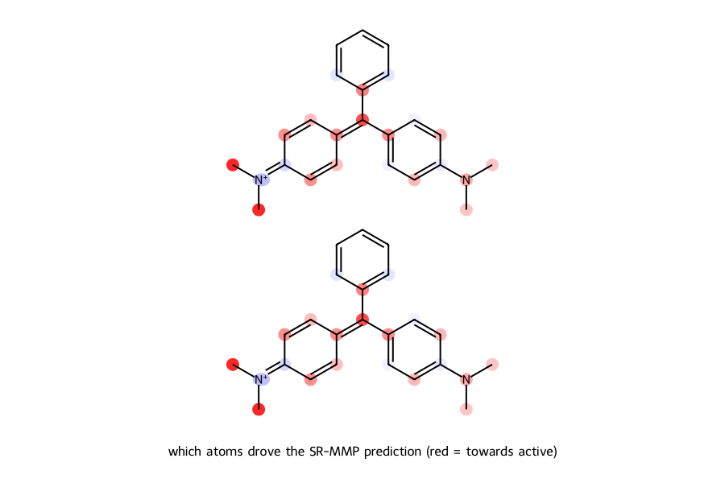

# gnn-for-molecules

**Graph neural networks on molecules, explained from scratch** — with a long
look at the graph convolution layer and at how information actually travels from
one atom to the next.



*Per-atom gradient attribution for an SR-MMP (mitochondrial toxicity)
prediction. Red atoms push the prediction towards "active", blue atoms push it
away. Produced by [notebook 08](notebooks/08_interpretation.ipynb) — the figure
is generated by the code in this repository, not drawn by hand.*

---

## Who this is for

Chemists and Ph.D. students who know Python and RDKit but have never built a
GNN. If you can parse a SMILES string and compute a descriptor, you have
everything you need to start.

**Clarity is the product.** Every layer here is implemented from scratch in
NumPy or plain PyTorch so you can read the arithmetic, and then checked
numerically against the PyTorch Geometric implementation so you know the
readable version is the real thing, not a simplification. Those checks run in
CI on every push.

## What you will learn

* How an RDKit molecule becomes `x`, `edge_index` and `edge_attr` — and why one
  bond becomes two directed edges.
* What one message-passing step does to the numbers, traced by hand on a
  five-atom molecule.
* What each piece of the graph convolution $\hat{A} = \tilde{D}^{-1/2}(A+I)\tilde{D}^{-1/2}$
  is for, and what breaks when you remove it.
* How GraphSAGE, GAT, GIN and Chemprop's D-MPNN differ, and when the difference
  matters on molecules.
* Why the readout (sum vs mean vs attention) is a modelling decision, not a
  formality.
* Why molecular GNNs are three layers deep and not thirty.
* How to train an honest toxicity model on Tox21: masked labels, class
  imbalance, scaffold splits, and a fingerprint baseline that has to be beaten.
* How to show a chemist which atoms drove a prediction — and how to check that
  the explanation is faithful before you believe it.
* Where the whole idea came from: Kireev's **ChemNet**, 1995.

## The notebooks

Read them in order; each one assumes the previous. Every notebook runs top to
bottom on a laptop CPU, and the versions in this repository are committed **with
their outputs**, so you can read them on GitHub without running anything.

| # | notebook | what it covers |
|---|---|---|
| 1 | [A molecule as a graph](notebooks/01_molecule_as_a_graph.ipynb) | atoms to nodes, bonds to edges, adjacency matrix, atom and bond feature vectors, the awkward cases (salts, lone ions) |
| 2 | [One message-passing step, by hand](notebooks/02_message_passing_by_hand.ipynb) | every intermediate number printed; watching a feature travel atom to atom; the receptive field |
| 3 | [Graph convolution proper](notebooks/03_graph_convolution.ipynb) | GCN, four candidate propagation matrices compared, self-loops, degree normalisation, dense vs sparse |
| 4 | [The layer zoo](notebooks/04_layer_zoo.ipynb) | GraphSAGE, GAT (with attention drawn on the molecule), GIN, D-MPNN; sum vs mean; all checked against PyG |
| 5 | [Readout and pooling](notebooks/05_readout_and_pooling.ipynb) | batching as one disconnected graph; sum vs mean vs attention; why sum matters for molecular size |
| 6 | [Oversmoothing](notebooks/06_oversmoothing.ipynb) | Dirichlet energy decay, 2/4/8/16 layers trained and plotted, residual connections, why molecules are small graphs |
| 7 | [End-to-end on Tox21](notebooks/07_tox21_end_to_end.ipynb) | NR-AR and SR-MMP, masked multi-task loss, scaffold vs random split, ROC-AUC and PR-AUC, random-forest baseline |
| 8 | [Interpretation](notebooks/08_interpretation.ipynb) | attention weights, gradient attribution, integrated gradients, a masking faithfulness check, explaining the model's mistakes |
| 9 | [ChemNet, 1995](notebooks/09_chemnet_1995_lineage.ipynb) | the lineage, and a working modern reconstruction of the 1995 architecture |

## The package

`mgnn/` holds the reference implementations the notebooks import.

```
mgnn/
├── features.py    RDKit -> graph tensors; atom and bond featurisation
├── layers.py      GCN, GraphSAGE, GAT, GIN, D-MPNN, written from scratch
├── pooling.py     sum, mean and attention readout
├── models.py      MolecularGNN: configurable depth, layer type and readout
├── chemnet.py     the 1995 ChemNet idea, reconstructed
├── data.py        Tox21 loading, missing-label masks, class-balance reporting
├── splits.py      Bemis-Murcko scaffold splitting
├── train.py       graph batching, masked BCE loss, training loop, metrics
├── interpret.py   attention weights, gradient and integrated-gradient attribution
└── viz.py         drawing molecules with per-atom weights
```

## Install

Python 3.10 or 3.11, CPU only. No GPU needed anywhere in this repository.

```bash
git clone https://github.com/hentablihamza/gnn-for-molecules.git
cd gnn-for-molecules

python -m venv .venv && source .venv/bin/activate
pip install torch==2.5.1 --index-url https://download.pytorch.org/whl/cpu
pip install -e ".[notebooks,dev]"
```

`requirements.txt` pins the exact versions this repository was built and tested
with (Python 3.11, `torch` 2.5.1+cpu, `torch-geometric` 2.6.1, `rdkit`
2024.9.6).

## Quickstart

Three minutes, no training:

```python
from mgnn.features import smiles_to_graph
from mgnn.layers import GCNLayer, gcn_normalised_adjacency

graph = smiles_to_graph("CC(=O)Nc1ccc(O)cc1")          # paracetamol
print(graph)
# MolGraph(smiles='CC(=O)Nc1ccc(O)cc1', nodes=11, directed_edges=22)

A_hat = gcn_normalised_adjacency(graph.edge_index, graph.num_nodes)
layer = GCNLayer(graph.x.shape[1], 32)
print(layer(graph.x, graph.edge_index).shape)           # torch.Size([11, 32])
```

Train the Tox21 model from notebook 7:

```python
import torch
from mgnn.data import WORKED_TASKS, load_tox21_graphs
from mgnn.models import MolecularGNN
from mgnn.splits import scaffold_split
from mgnn.train import evaluate, train_model

ds = load_tox21_graphs(tasks=WORKED_TASKS)              # vendored, runs offline
tr, va, te = scaffold_split(ds.smiles, 0.8, 0.1, 0.1)
model = MolecularGNN(n_tasks=2, hidden_dim=64, n_layers=3,
                     layer_kind="gin", pooling="sum")
train_model(model, ds.subset(tr).graphs, ds.subset(va).graphs, WORKED_TASKS,
            epochs=40, pos_weight=torch.tensor([5.0, 3.0]))
print(evaluate(model, ds.subset(te).graphs, WORKED_TASKS)["per_task"])
```

Run the notebooks:

```bash
jupyter lab notebooks/
```

## Tests

```bash
pytest          # the whole suite, CPU, no network, well under a minute
ruff check mgnn tests
```

The suite is not decoration. It asserts the two claims this repository rests on:

1. **The from-scratch layers are the real thing.** Parameters are copied out of
   `GCNConv`, `SAGEConv`, `GATConv` and `GINConv` into the hand-written layers
   and the outputs are compared on real molecules — including the attention
   coefficients, head by head. D-MPNN has no PyTorch Geometric counterpart, so
   it is pinned against an independently written loop-based reference taken
   straight from the equations in the paper.
2. **The scaffold split does not leak.** No Bemis-Murcko scaffold appears in
   more than one of train, validation and test — checked on the real Tox21 set,
   not just a toy list.

Plus the things that are easy to get silently wrong: batching never lets
messages cross between molecules, attention pooling is scoped to one molecule
(so a prediction cannot depend on batch composition), and the masked loss gives
exactly zero gradient for unmeasured labels.

## Data

Tox21 (7,831 compounds, 12 assays) from MoleculeNet, vendored in `data/` so
every notebook runs offline. Provenance, the two worked assays, the missing-label
and class-imbalance caveats, and the references are in
[`data/README.md`](data/README.md).

## A note on the numbers in these notebooks

Every number reported in these notebooks came out of the run that is committed
with them. They are **single-seed, single-split, CPU-sized** results from short
training runs chosen so the notebooks stay laptop-friendly, and the comparison
tables in notebooks 4, 5 and 6 train on subsets for a handful of epochs. They
are there to show the machinery works and to give a feel for the direction of
effects — they are not benchmark results, and the notebooks say so where it
matters. If you want publishable numbers, run several seeds and several scaffold
splits with the same code.

---

## ChemNet, 1995: the lineage

> **Kireev, D. B.** "ChemNet: A Novel Neural Network Based Method for
> Graph/Property Mapping." *J. Chem. Inf. Comput. Sci.* **1995**, *35* (2),
> 175-180. DOI: [10.1021/ci00024a001](https://doi.org/10.1021/ci00024a001)

ChemNet was **among the first** neural networks to map a molecular graph
*directly* into the architecture of the network, instead of first compressing the
molecule into a fixed vector of descriptors. Each non-hydrogen atom had its own
neuron, and the connection weights between neurons were tied to the
**topological distance** between the atoms they joined: every pair of atoms two
bonds apart shared one weight, every pair three bonds apart shared another.

That is weight sharing over graph structure, which is the central idea modern
graph convolution rests on — written down in 1995.

**On priority, carefully.** The University of Missouri Chemistry department's
page for Prof. Kireev describes ChemNet as *"the first published instance of a
graph-convolutional network architecture"*
([chemistry.missouri.edu/people/kireev](https://chemistry.missouri.edu/people/kireev));
that claim is theirs and is attributed to them here rather than asserted as
fact. Kireev himself has been more cautious in public, writing in 2025 that it
*"might have been among the first"*, and describing how in a single layer
messages were passed to a node from all other nodes, in a Transformer-like
fashion. This repository follows his framing.

ChemNet was also not alone. Two contemporaneous architectures built the network
from the molecular graph in related ways:

* **Baskin, I. I.; Palyulin, V. A.; Zefirov, N. S.** "A Neural Device for
  Searching Direct Correlations between Structures and Properties of Chemical
  Compounds." *J. Chem. Inf. Comput. Sci.* **1997**, *37* (4), 715-721.
  DOI: [10.1021/ci940128y](https://doi.org/10.1021/ci940128y)
* **Ivanciuc, O.** — **MolNet**, a multilayer perceptron whose input-hidden
  connections encode the topological distance matrix and whose hidden-output
  connections are grouped by atom type. Reviewed in "Quantitative
  Structure-Activity Relationships (QSAR) with the MolNet Molecular Graph
  Machine." *Curr. Comput.-Aided Drug Des.* **2011**, *6* (2), 261-268.
  DOI: [10.2174/1574893611106020261](https://doi.org/10.2174/1574893611106020261)

Ivanciuc's review chapter "Molecular Graph Descriptors Used in Neural Network
Models" (in *Topological Indices and Related Descriptors in QSAR and QSPR*,
Devillers, J.; Balaban, A. T., Eds.; Gordon & Breach, 1999, pp. 697-777)
discusses all three together as networks generated from the molecular graph.

[Notebook 9](notebooks/09_chemnet_1995_lineage.ipynb) does not just describe
ChemNet, it **rebuilds the idea in code** (`mgnn/chemnet.py`): a layer in which
every atom is updated from every other atom at once, with one learned weight
matrix per topological-distance shell. The notebook shows that

* a one-hop GCN layer is the special case where every weight past $d = 1$ is
  zero, and
* one ChemNet layer reaches the whole molecule, where a GCN layer reaches one
  bond — so the "attend to all atoms, biased by graph distance" pattern that
  graph transformers arrived at in the 2020s is close to where this started.

### Acknowledgement

With thanks to **Prof. Dmitri Kireev**, whose 1995 ChemNet paper is the starting
point for notebook 9 and for much of what the rest of this repository teaches.
Any errors in characterising that work are mine.

---

## Key references

All verified; none of these is a placeholder.

* Kireev, D. B. *J. Chem. Inf. Comput. Sci.* **1995**, *35* (2), 175-180. DOI: [10.1021/ci00024a001](https://doi.org/10.1021/ci00024a001) — ChemNet.
* Bemis, G. W.; Murcko, M. A. *J. Med. Chem.* **1996**, *39* (15), 2887-2893. DOI: [10.1021/jm9602928](https://doi.org/10.1021/jm9602928) — molecular frameworks (scaffolds).
* Baskin, I. I.; Palyulin, V. A.; Zefirov, N. S. *J. Chem. Inf. Comput. Sci.* **1997**, *37* (4), 715-721. DOI: [10.1021/ci940128y](https://doi.org/10.1021/ci940128y).
* Duvenaud, D. et al. NeurIPS **2015**. DOI: [10.48550/arXiv.1509.09292](https://doi.org/10.48550/arXiv.1509.09292) — neural fingerprints.
* Huang, R. et al. *Front. Environ. Sci.* **2016**, *3*, 85. DOI: [10.3389/fenvs.2015.00085](https://doi.org/10.3389/fenvs.2015.00085) — the Tox21 challenge.
* Gilmer, J. et al. ICML **2017**. DOI: [10.48550/arXiv.1704.01212](https://doi.org/10.48550/arXiv.1704.01212) — the MPNN framework.
* Kipf, T. N.; Welling, M. ICLR **2017**. DOI: [10.48550/arXiv.1609.02907](https://doi.org/10.48550/arXiv.1609.02907) — GCN.
* Hamilton, W.; Ying, Z.; Leskovec, J. NeurIPS **2017**. DOI: [10.48550/arXiv.1706.02216](https://doi.org/10.48550/arXiv.1706.02216) — GraphSAGE.
* Veličković, P. et al. ICLR **2018**. DOI: [10.48550/arXiv.1710.10903](https://doi.org/10.48550/arXiv.1710.10903) — GAT.
* Li, Q.; Han, Z.; Wu, X.-M. AAAI **2018**. DOI: [10.48550/arXiv.1801.07606](https://doi.org/10.48550/arXiv.1801.07606) — oversmoothing.
* Wu, Z. et al. *Chem. Sci.* **2018**, *9*, 513-530. DOI: [10.1039/C7SC02664A](https://doi.org/10.1039/C7SC02664A) — MoleculeNet.
* Xu, K. et al. ICLR **2019**. DOI: [10.48550/arXiv.1810.00826](https://doi.org/10.48550/arXiv.1810.00826) — GIN.
* Yang, K. et al. *J. Chem. Inf. Model.* **2019**, *59* (8), 3370-3388. DOI: [10.1021/acs.jcim.9b00237](https://doi.org/10.1021/acs.jcim.9b00237) — D-MPNN / Chemprop.
* Oono, K.; Suzuki, T. ICLR **2020**. DOI: [10.48550/arXiv.1905.10947](https://doi.org/10.48550/arXiv.1905.10947) — expressive power lost with depth.
* Alon, U.; Yahav, E. ICLR **2021**. DOI: [10.48550/arXiv.2006.05205](https://doi.org/10.48550/arXiv.2006.05205) — oversquashing.
* Sundararajan, M.; Taly, A.; Yan, Q. ICML **2017**. DOI: [10.48550/arXiv.1703.01365](https://doi.org/10.48550/arXiv.1703.01365) — integrated gradients.

Full reference lists, including the interpretability debate and the
long-range-information literature, are inside the notebooks that use them.

## Citing this repository

```bibtex
@software{hentabli_gnn_for_molecules,
  author = {Hentabli, Hamza},
  title  = {gnn-for-molecules: graph neural networks on molecules, explained from scratch},
  year   = {2026},
  url    = {https://github.com/hentablihamza/gnn-for-molecules}
}
```

## Author

**Hentabli Hamza, Ph.D.** — computational chemistry and cheminformatics.
GitHub: [@hentablihamza](https://github.com/hentablihamza)

## Licence

MIT, see [LICENSE](LICENSE). The licence covers the **code**; the Tox21 data in
`data/` is public data redistributed by MoleculeNet/DeepChem — see
[`data/README.md`](data/README.md).
